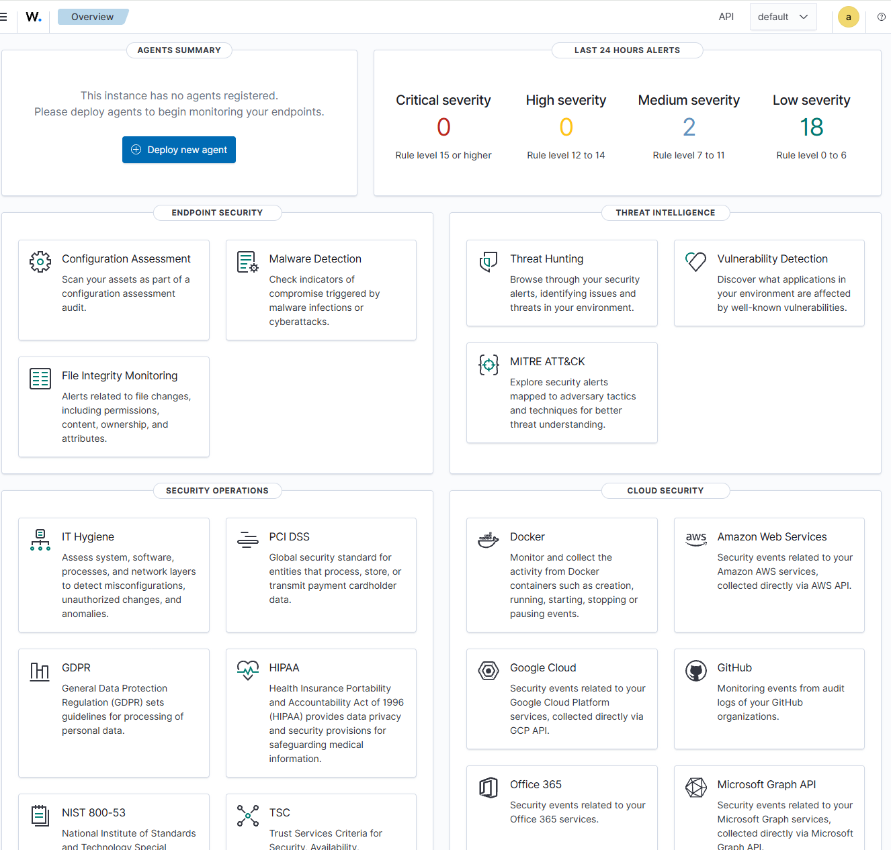

# AI Alert Triage Assistant

An LLM-powered assistant that triages security alerts like a Tier 1 SOC analyst. It reads SIEM alerts, decides whether each one is malicious, maps it to MITRE ATT&CK, and recommends next steps. Its verdicts are then **measured against a human analyst's** to see where AI triage can be trusted and where it fails.

> **Status:** Early prototype. Tested on sample alerts; home lab testing (Wazuh + Windows + Atomic Red Team) in progress.

## Why I built this

SOC teams are flooded with alerts, and most are noise. AI is increasingly used to speed up triage, but an AI that confidently mislabels a real attack as "benign" is worse than no AI at all.

I come from 8 years in SOX and cybersecurity audit (CISA, CISM). This project applies an auditor's mindset to AI in security operations: **don't trust the control until you've tested it.**

## How it works

```
SIEM alerts (Wazuh JSON)  ->  triage.py  ->  Claude (LLM)  ->  triage_results.csv
                                                                     |
                                                     analyst reviews & scores accuracy
```

For each alert, the script:

1. **Trims the alert** to the fields that matter (rule, host, process, command line) to cut noise and cost
2. **Asks the LLM** to return a structured verdict:
   - `verdict`: `true_positive`, `benign`, or `needs_investigation`
   - `severity`: `low` to `critical`
   - `mitre_technique`: e.g. `T1003.001 LSASS Memory`
   - `summary` and `next_steps` in plain English
   - `confidence`: 0 to 1
3. **Writes results to a CSV**, with an empty `analyst_verdict` column for human review

## Sample results

Initial test on 5 hand-crafted alerts with known answers:

| Alert | Expected | AI verdict | Correct? |
|---|---|---|---|
| PowerShell encoded command launched from Word | True positive | true_positive* | ✅ |
| LSASS memory accessed by procdump | True positive | true_positive | ✅ |
| Google Updater service created | Benign | benign | ✅ |
| Single failed admin logon | Needs investigation | needs_investigation | ✅ |
| SSH login from internal IP | Needs investigation | needs_investigation | ✅ |

\* On this alert the script crashed with `'ThinkingBlock' object has no attribute 'text'`. On the most complex alert, the model reasoned before answering, so its reply started with a "thinking" block instead of the answer, and the code only read the first block. Fixed by reading only the text blocks of the reply. Re-tested: correctly classified as `true_positive`, bringing the sample set to **5/5 correct**. **Lesson: the most dangerous alerts trigger the most AI reasoning, so the code must not assume a fixed response shape. A triage tool that silently fails on the worst alerts is a dangerous control gap.**

## Getting started

**Requirements:** Python 3.10+, an [Anthropic API key](https://console.anthropic.com)

```bash
pip install -r requirements.txt

# Preview what gets sent to the AI (no API call, no cost)
python triage.py sample_alerts.json --dry-run

# Run triage (PowerShell)
$env:ANTHROPIC_API_KEY="your-key-here"
python triage.py sample_alerts.json
```

Results are saved to `triage_results.csv`.

## Lab environment

To move beyond synthetic alerts, I'm building a home SOC lab that generates real security telemetry.

| Component | Details |
|---|---|
| Hypervisor | VirtualBox on a Windows host (32 GB RAM) |
| SIEM | Wazuh 4.14 (all-in-one: manager, indexer, dashboard) |
| Network | **Host-only network**: lab VMs are isolated from my home network and only reachable from the host |
| Endpoint | Windows 11 VM with Sysmon + Wazuh agent *(in progress)* |
| Attack simulation | Atomic Red Team, run only inside the isolated endpoint VM *(planned)* |



*Wazuh dashboard running in the isolated lab. Alerts mapped to MITRE ATT&CK and to compliance frameworks (PCI DSS, NIST 800-53, GDPR, HIPAA, TSC).*

**Planned pipeline:**

```
Atomic Red Team attack -> Windows + Sysmon -> Wazuh alert -> triage.py -> AI verdict -> analyst scoring
```

## Security considerations

- **No secrets in code.** The API key is read only from an environment variable and never written to disk.
- **No real data.** Sample alerts are synthetic. Real production logs should never be sent to an external AI service without organizational approval.
- **Human in the loop.** The AI recommends; an analyst decides. High-severity alerts should always get human review regardless of the AI's verdict.
- **Isolated lab.** Live testing runs in a host-only virtual network, separated from my home network.

## Roadmap

- [x] Triage sample alerts with structured LLM output
- [x] Robust parsing of AI responses (handles reasoning/"thinking" blocks)
- [x] 5/5 correct on sample alerts
- [x] Home lab: Wazuh SIEM deployed on an isolated host-only network
- [ ] Harden lab: replace default credentials
- [ ] Windows 11 endpoint with Sysmon + Wazuh agent
- [ ] Generate real alerts with Atomic Red Team attack simulations
- [ ] Score 100+ alerts: accuracy, false negatives, false positives
- [ ] Improve the prompt with environment context and re-measure
- [ ] Enrichment: VirusTotal lookups, base64 command decoding
- [ ] Guardrail: auto-escalate high-severity alerts to a human

## Skills demonstrated

Python · LLM integration (Anthropic API) · Prompt engineering · SIEM (Wazuh) · MITRE ATT&CK · Alert triage · Control testing and validation · Secure secrets handling
